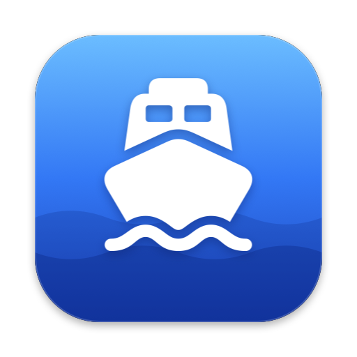

<p align="center">
  
</p>

<h1 align="center">Ferry</h1>

<p align="center">A tiny menu bar and tray app that carries files between desktops, on macOS and Windows.</p>

---

Moving a file to a window on another desktop usually means juggling Mission
Control or Task View mid-drag. Ferry gives you a small floating shelf instead:
drop files on it, switch desktops, and drag them out where they belong.

The repository holds two native apps that work the same way:

| Folder | App |
| --- | --- |
| [`macos/`](macos) | Swift and SwiftUI, a menu bar app for macOS 14 and later |
| [`windows/`](windows) | C# and WinUI 3, a tray app for Windows 10 and 11 |
| `Resources/` | The shared app icon |

## macOS

### How it works

1. Start dragging files in Finder, or photos, images and mail from Photos, your
   browser or Mail. The shelf slides in at the edge of the screen (or press
   <kbd>⌃</kbd> <kbd>⌥</kbd> <kbd>F</kbd> to bring it up yourself).
2. Drop them on the shelf.
3. Switch to another desktop (<kbd>⌃</kbd> <kbd>←</kbd> / <kbd>→</kbd> or a swipe). The shelf comes along.
4. Drag the pile out to its destination. Finder moves the files on the same disk
   and copies them to another disk; hold <kbd>⌥</kbd> to force a copy.

Need the files in different places? Click the pile (or the list button) to see
each file. Drag a single row out on its own, or tick a few with the circles
(<kbd>⌘</kbd>-click and <kbd>⇧</kbd>-click work too) and drag them together.
The rest stay on the shelf for the next stop.

Ferry only keeps references. Files stay where they are until you drag them out,
and they leave the shelf as soon as they land somewhere else. Photos, browsers
and Mail don't hand over a file, only a promise to write one, so Ferry has them
write it to a `Ferry Inbox` folder in the temporary directory first; it's
emptied the next time Ferry starts.

### Features

- Lives in the menu bar, not the Dock. The ferry icon fills in and shows a count
  when files are waiting.
- The shelf appears on every desktop and over full-screen apps, without ever
  stealing focus from the app you're working in.
- Liquid Glass on macOS 26 and later, a vibrant blur on macOS 14–15.
- Quick Look thumbnails, fanned out like a small pile.
- A file list for picking which files to drag: single rows, ticked files or
  Finder-style ⌘/⇧ selection. Double-click a row to open the file.
- Right-click to open files, show them in Finder, remove them from the shelf or
  clear it.
- Takes photos from Photos, images from Safari and other browsers, and messages
  and attachments from Mail.
- A global shortcut, <kbd>⌃</kbd> <kbd>⌥</kbd> <kbd>F</kbd> by default, shows
  and hides the shelf from any app.
- Pick where the shelf appears: the right, left, top or bottom edge, next to the
  pointer, or anywhere you drag it by its edge.
- Settings (<kbd>⌘</kbd> <kbd>,</kbd> from the menu bar menu): show while
  dragging, the shortcut, the position, launch at login.

Ferry needs no permissions: it watches for drags with a global mouse monitor
and registers its shortcut as a Carbon hot key, and neither requires
Accessibility access.

### Build and run

Requires macOS 14 or later and Xcode 16 or later (Swift 6). The Mac app lives
in `macos/`; run these from there:

```bash
cd macos
make run        # build build/Ferry.app and launch it
make install    # copy it to /Applications and launch it
make app        # just build build/Ferry.app
swift test      # run the unit tests
```

The app is ad-hoc signed for local use. Install it to `/Applications` before
turning on **Launch at Login**.

To work on it in Xcode, open `macos/Package.swift`.

> **Note:** if the repository lives in an iCloud-synced folder (Desktop &
> Documents), iCloud tags build products with Finder info and `codesign` refuses
> to sign the test bundle. Build outside the synced folder, for example
> `swift test --scratch-path /tmp/ferry-build`. `make app` already keeps
> `macos/build` and `macos/.build` out of iCloud.

### Project layout

| Path | What's inside |
| --- | --- |
| `macos/Sources/Ferry/FerryApp.swift` | Entry point, runs as a menu bar–only app |
| `macos/Sources/Ferry/Shelf.swift` | The shelf model: parked files and their metadata |
| `macos/Sources/Ferry/ShelfPanel.swift` | Floating, non-activating panel on every Space |
| `macos/Sources/Ferry/ShelfPanelController.swift` | Showing, hiding and positioning the panel |
| `macos/Sources/Ferry/ShelfView.swift` | The SwiftUI shelf: drop zone, pile, file list, footer |
| `macos/Sources/Ferry/FileDragArea.swift` | AppKit drop target and multi-file drag source |
| `macos/Sources/Ferry/FileSelection.swift` | Finder-style selection for the file list |
| `macos/Sources/Ferry/Inbox.swift` | Receives files promised by Photos, browsers and Mail |
| `macos/Sources/Ferry/DragMonitor.swift` | Detects file drags in other apps |
| `macos/Sources/Ferry/StatusItemController.swift` | Menu bar icon and menu |
| `macos/Sources/Ferry/Preferences.swift` | Saved settings |
| `macos/Sources/Ferry/ShelfPosition.swift` | Where on screen the shelf appears |
| `macos/Sources/Ferry/GlobalHotKey.swift`, `KeyShortcut.swift` | The show/hide shortcut |
| `macos/Sources/Ferry/SettingsView.swift`, `ShortcutRecorder.swift` | The settings window |
| `macos/scripts/build-app.sh` | Assembles and signs `Ferry.app` |
| `macos/scripts/make-icon.swift` | Draws the app icon for both apps (run `swift scripts/make-icon.swift` from `macos/`) |

## Windows

### How it works

1. Start dragging files in File Explorer or on the desktop, attachments or
   messages in Outlook, or an image in your browser. The shelf slides in at the
   edge of the screen, out of the way of the pointer. Or press
   <kbd>Ctrl</kbd> <kbd>Alt</kbd> <kbd>F</kbd> to bring it up yourself.
2. Drop them on the shelf.
3. Switch to another desktop (<kbd>Ctrl</kbd> <kbd>Win</kbd> <kbd>←</kbd> /
   <kbd>→</kbd> or Task View). The shelf comes along.
4. Drag the pile out to its destination. File Explorer moves the files on the
   same drive and copies them to another drive; hold <kbd>Ctrl</kbd> to copy,
   <kbd>Shift</kbd> to move or <kbd>Alt</kbd> to make a shortcut.

Need the files in different places? Click the pile (or the list button) to see
each file. Drag a single row out on its own, or select a few with
<kbd>Ctrl</kbd>-click and <kbd>Shift</kbd>-click and drag them together. The
rest stay on the shelf for the next stop.

As on the Mac, Ferry only keeps references and files leave the shelf once they
land somewhere else. Outlook, browsers and zip folders hand over a file's
contents rather than the file, so Ferry writes those to a `Ferry Inbox` folder
in `%TEMP%` first; it's emptied the next time Ferry starts.

### Features

- Lives in the notification area, not on the taskbar. Click the icon to show or
  hide the shelf, right-click it for the menu, hover it to see how many files
  are waiting.
- The shelf floats above other windows on every virtual desktop and never takes
  the keyboard from the app you're working in.
- Acrylic glass and rounded corners on Windows 11, File Explorer thumbnails
  fanned out like a small pile.
- A file list with File Explorer–style selection: <kbd>Ctrl</kbd>-click,
  <kbd>Shift</kbd>-click, double-click to open.
- Right-click to open files, show them in File Explorer, remove them from the
  shelf or clear it.
- Takes attachments and whole messages from Outlook, images from browsers and
  files from inside zip folders.
- A global shortcut, <kbd>Ctrl</kbd> <kbd>Alt</kbd> <kbd>F</kbd> by default.
- Pick where the shelf appears: the right, left, top or bottom edge, next to the
  pointer, or anywhere you drag it by its edge.
- Settings (right-click the tray icon): show while dragging, the shortcut, the
  position, launch at login.

Windows doesn't tell other apps when a drag begins, so Ferry watches the left
mouse button with a low-level mouse hook, which needs no administrator rights.
While the button is held down and moving, it looks for the drag image Windows
draws under the pointer (File Explorer, the desktop and browsers draw one) or
for OLE taking hold of the mouse, and slides the shelf in as soon as it sees
either. That can also be a drag of text or a link; the shelf goes away again
when such a drag ends. As a fallback, an invisible 2-pixel drop target waits
along the shelf's edge of every screen (both sides when the shelf sits next to
the pointer or in a spot of your own) and catches file drags that reach it.
All of this exists only mid-drag, so it never catches a click.

If something doesn't work, `%LOCALAPPDATA%\Ferry\Ferry.log` records what Ferry
noticed along the way.

### Build and run

Requires Windows 10 version 1809 or later and the [.NET 10
SDK](https://dotnet.microsoft.com/download). Run these from `windows/`:

```powershell
dotnet run --project Ferry                  # build and launch
dotnet test Ferry.Core.Tests                # run the unit tests
dotnet publish Ferry -c Release -o publish  # a self-contained build in publish\
```

Add `-p:Platform=ARM64` for ARM PCs; the default is x64. To work on it in
Visual Studio, install the WinUI application development workload and open
`windows/Ferry.sln`.

Ferry is an unpackaged app that carries the Windows App SDK and .NET with it,
so the `publish` folder runs on any PC without installing anything. Put it
where it will stay before turning on **Launch at login**.

The shared code in `Ferry.Core` builds and tests on macOS and Linux too. The
app itself only builds on Windows; GitHub Actions builds it on every push and
attaches the result to the run.

### Project layout

| Path | What's inside |
| --- | --- |
| `windows/Ferry.Core/` | Platform-neutral code: the shelf model, where the shelf goes, the shortcut, settings, Outlook and browser file lists, the inbox |
| `windows/Ferry.Core.Tests/` | Unit tests for `Ferry.Core` |
| `windows/Ferry/Program.cs`, `SingleInstance.cs` | Entry point, keeps Ferry to one copy |
| `windows/Ferry/App.xaml.cs` | Ties the shelf, tray icon, shortcut and drag watcher together |
| `windows/Ferry/ShelfWindow.cs` | The shelf: drop zone, pile, file list, footer |
| `windows/Ferry/ShelfController.cs` | Showing, hiding and positioning the shelf |
| `windows/Ferry/DragWatcher.cs` | Notices file drags: mouse hook, drag image, edge strips |
| `windows/Ferry/DroppedFiles.cs` | Reads dropped files, real and virtual |
| `windows/Ferry/Interop/DropTarget.cs` | OLE drop target for the shelf and the edge strips |
| `windows/Ferry/ShellFiles.cs` | Dragging files out, opening them, showing them in File Explorer |
| `windows/Ferry/VirtualDesktopFollower.cs` | Keeps the shelf on the current virtual desktop |
| `windows/Ferry/TrayIcon.cs`, `NativeMenu.cs` | Notification area icon and menus |
| `windows/Ferry/HotKey.cs` | The global shortcut |
| `windows/Ferry/SettingsWindow.cs`, `ShortcutRecorder.cs` | The settings window |
| `windows/Ferry/Log.cs` | The diagnostic log |
| `.github/workflows/windows.yml` | Builds and tests the Windows app |

## License

MIT, see [LICENSE](LICENSE).
